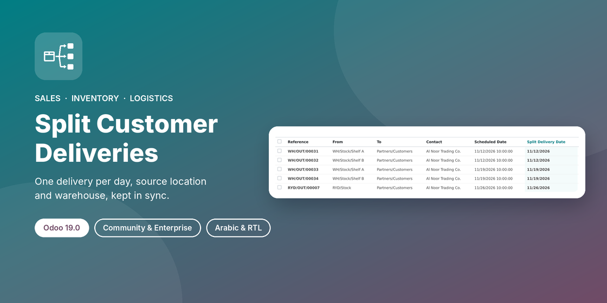

# Split Customer Deliveries (`sale_split_delivery`)


Odoo 19.0 module that gives every sales order line its own **Expected Delivery** date, **Source Location** and **Delivery Warehouse**, and splits the delivery orders of a confirmed sales order by those criteria. It is the sales counterpart of `purchase_split_grn`.



## Features

- **Expected Delivery on order lines.** Standard Odoo has no line-level delivery date. This one follows the order **Delivery Date** and can be changed per line; left empty, Odoo's standard lead-time date applies. Line dates also drive the order's **Expected Date**.
- **Three independent split criteria.** Split by delivery date, by source location and/or by warehouse. Each can be enabled on its own, per company.
- **One delivery order per combination.** On confirmation, deliveries are grouped by local delivery day, source location and warehouse.
- **Multi-step routes.** In pick/pack/ship warehouses the pick step is split by location and day, and the shipping step by day.
- **Rescheduling after confirmation.** Changing a line's date or location, or the order's Delivery Date, moves pending moves to the matching delivery, redoes the reservation and deletes deliveries left empty, with a note in the chatter. Moves already worked on are never moved.
- **Arabic (`ar_001`) translation** and right-to-left friendly views.

## Configuration

**Sales › Configuration › Settings › Outbound Logistics**: tick **Split Customer Deliveries**, then tick one or more of **Split by Delivery Date**, **Split by Source Location** and **Split by Warehouse**. The matching columns then appear on sales order lines.

## Installation

1. Put the `sale_split_delivery` folder (or this repository, checked out on the `19.0` branch) in your addons path.
2. Update the apps list and install **Split Customer Deliveries**.

It depends only on `sale_stock`.

## Tests

```bash
odoo-bin -d <database> -i sale_split_delivery --test-tags /sale_split_delivery --stop-after-init
```

18 tests cover line dates, each criterion alone and combined, a pick + ship route, rescheduling and empty-delivery removal, quantity increases, processed moves, the location and warehouse guards, and transfers that don't come from sales.

## Branches

| Branch | Odoo version | |
|---|---|---|
| [`16.0`](../../tree/16.0) | Odoo 16.0 |  |
| [`17.0`](../../tree/17.0) | Odoo 17.0 |  |
| [`18.0`](../../tree/18.0) | Odoo 18.0 |  |
| [`19.0`](../../tree/19.0) | Odoo 19.0 | **this branch** |

Notes for this version: Moves and deliveries are linked by **stock references** (`reference_ids`) instead of procurement groups; messages use `self.env._()`; install SQL uses `odoo.tools.SQL`.

## Author & support

**Ibrahim Yahia**: [LinkedIn](https://www.linkedin.com/in/ibrahim-yahia) · ibrahim.yahiah@gmail.com

## License

[LGPL-3](https://www.gnu.org/licenses/lgpl-3.0.html)
